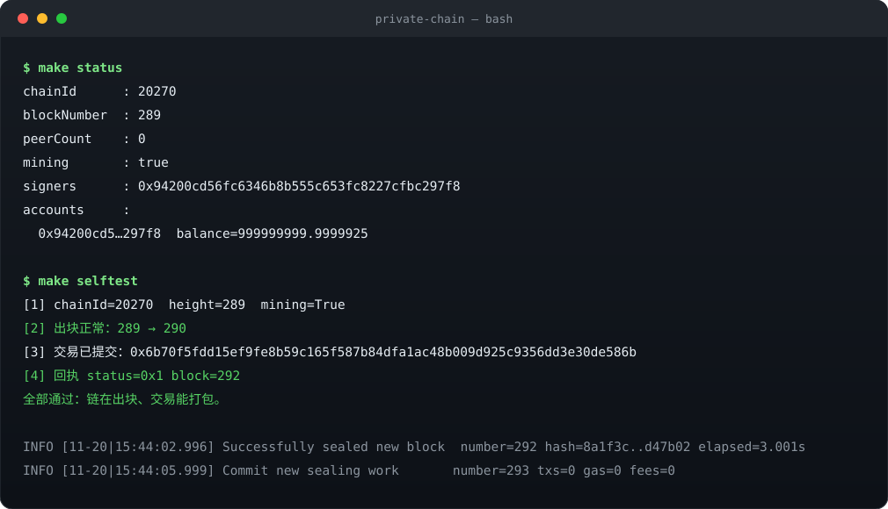

# AEGIS Private Chain (go-ethereum / Clique PoA)

**English | [中文](README.md)**

A ready-to-run scaffolding for an Ethereum-compatible chain you fully control: **your own chainId, your own sealer, data staying on your machine or LAN**. Built for DApp integration, contract rehearsal and internal demos — not for mainnet.



## Verified, not theoretical

Everything below was actually executed on 2026-11-20 against geth 1.13.15:

| Step | Result |
| --- | --- |
| `make account` | sealer account `0x9420…97f8` created |
| `make genesis && make init` | `Successfully wrote genesis state` |
| `make start` | a block every 3s, `mining=true`, `clique.getSigners()` returns the local account |
| 0.5 ETH transfer | receipt `status=0x1`, `gasUsed=21000`, included in a block |
| second node | same genesis + `--bootnodes`, height in sync with node 1 |
| deploy an ERC-20 (solc 0.8.26, `evmVersion: "london"`) | `status=0x1`, `totalSupply()` reads 1,000,000 |
| `make selftest` | all four checks pass: chainId / sealing / tx / receipt |

## Three pitfalls this repo already solves

1. **Clique rejects shanghai/cancun block structures.** With `shanghaiTime` in genesis the node happily seals blocks, but peers drop the connection with `clique does not support shanghai fork`. The `legacy` profile therefore strips shanghai/cancun, making the chain **pure London** — contracts must be compiled with `evmVersion: "london"`, otherwise solc 0.8.26 emits `PUSH0`, an invalid opcode here that makes the deploy revert.
2. **A second node needs a different `--authrpc.port`.** geth defaults every instance to 8551, so node 2 dies with `bind: address already in use`. This repo pins node 1 = 8551, node 2 = 8552.
3. **`--unlock` over HTTP is refused.** geth requires `--allow-insecure-unlock` (`Account unlock with HTTP access is forbidden!`). Safe only because RPC binds to 127.0.0.1 — do not copy this onto a public endpoint.

## Version compatibility (read this first)

Every major geth release tightens PoA support:

| geth | Can it seal a private PoA chain? | Behaviour |
| --- | --- | --- |
| **1.13.x (recommended, default here)** | ✅ yes | `--unlock` and Clique sealing still present |
| 1.14.x / 1.15.x | ❌ no | refuses to start: `only PoS networks are supported` |
| 1.16+ (e.g. 1.17.10) | ❌ no | `--unlock` removed, `clef` removed, needs an external consensus client |

Pin geth to 1.13.15 first:

```bash
# Go (lock the toolchain: geth 1.13 fails to link on newer Go with a memsize reference error)
GOTOOLCHAIN=go1.21.13 GOBIN=$HOME/go/bin go install github.com/ethereum/go-ethereum/cmd/geth@v1.13.15
export PATH=$HOME/go/bin:$PATH && geth version    # expect 1.13.15-stable

# or Docker
docker run -it --rm -p 8545:8545 -p 30303:30303 \
  ethereum/client-go:v1.13.15 --datadir /root/.ethereum \
  --http --http.addr 0.0.0.0 --http.api eth,net,web3,personal,clique --networkid 20270
```

`make install` does this for you. If you only want to run contracts and do not care about the chain, use `make dev` (`geth --dev`) or `anvil --chain-id 20270`.

`04-start-sealer.sh` probes the binary first: on an unsupported version it says so and exits instead of failing halfway.

## Quick start (5 commands)

```bash
make account        # 1 create sealer account, password stored in password.txt
make genesis        # 2 build genesis.json with that signer (1e26 wei pre-funded)
make init           # 3 initialise chaindata
make start          # 4 run the sealing node in the foreground (separate terminal)
make status         # 5 chainId / height / sealer / accounts
make selftest       # 6 optional: sealing + tx + receipt end-to-end
```

Requirements: `geth 1.13.15`, `curl`, `jq` (used by `05-status.sh`), `python3` (builds genesis.json), `bash 4+`.

Defaults: **chainId 20270, block every 3s, RPC http://127.0.0.1:8545, P2P 30303**.
Change them: `CHAINID=8801 PERIOD=5 make genesis`.
`make genesis` uses `PROFILE=legacy` (sealable on geth ≤1.13); `PROFILE=modern` produces the post-merge config for 1.14+, reference only — it cannot seal.

## Why these parameters

| Field | Value | Reason |
| --- | --- | --- |
| `config.chainId` | 20270 | network identity for wallets/frontends; must not collide with mainnet 1 or Sepolia 11155111 |
| `clique.period` | 3 | block interval in seconds; 3s is fine for contract work, 1s if you want speed |
| `clique.epoch` | 30000 | re-computes the signer set every N blocks (PoA governance) |
| `gasLimit` | `0x1c9c380` = 30,000,000 | per-block gas ceiling, enough for an ERC-20 deploy |
| `difficulty` | `0x1` | placeholder under Clique, not real mining difficulty |
| `alloc` | sealer pre-funded | **a PoA chain still charges gas, no balance means nothing works** |
| `terminalTotalDifficulty` | omitted in `legacy` | present ⇒ geth 1.14+ treats the chain as post-merge and refuses to start |

> `01-new-account.sh` generates a random password into `password.txt`. **Lose that file and the account is unusable** — always back up keystore + password together (`make backup`).

## Using it from a phone

| Route | Requirement | When |
| --- | --- | --- |
| **A. Chain on a computer, phone on the same Wi-Fi** | one always-on machine | easiest, home/LAN |
| **B. Chain on a VPS + tunnel** | VPS + tailscale/ngrok | you are outside the LAN |
| **C. Chain on the phone itself (Termux)** | Android + Termux, ~100MB | fully portable, no network dependency |

### A. Desktop chain, phone client

```bash
make lan          # same as ./scripts/09-lan-start.sh; prints the URL to type into your wallet
```

Then add a custom network in MetaMask (or TokenPocket / Trust):

```
Network name  AEGIS private chain
RPC URL       http://192.168.x.x:8545
Chain ID      20270
Symbol        ETH
Explorer      leave empty
```

To sign on the phone, import the `keystore/UTC--...json` file (MetaMask → Import account → JSON; geth keystores are standard v3). **That also hands sealing power to the phone** — fine for a test chain, never for real funds.

### B. VPS + tunnel (no public port)

```bash
curl -fsSL https://tailscale.com/install.sh | sh && sudo tailscale up
```

Point the phone at the `100.x.x.x` address. Do not expose 8545 publicly; that effectively publishes your sealer account.

### C. Termux

```bash
pkg install -y golang git curl
export GOTOOLCHAIN=go1.21.13        # mandatory: Termux ships a newer Go and geth 1.13 fails to link
go install github.com/ethereum/go-ethereum/cmd/geth@v1.13.15
export PATH=$HOME/go/bin:$PATH && geth version
```

Then run the usual `make account && make genesis && make init && make start` inside the cloned directory and connect the wallet to `http://127.0.0.1:8545`.

## Multi-node

```bash
geth attach http://127.0.0.1:8545 --exec "admin.nodeInfo.enode"
make node2 ENODE="enode://<pubkey>@127.0.0.1:30303"
```

- node 2 must use the **same genesis.json** and the **same networkid**, or it will connect but never sync
- node 2 exposes RPC on 8546, discovery via `--bootnodes`
- to let node 2 seal too: `clique.propose("<node2 address>", true)` on node 1, effective at the next `epoch`
- across machines: bind `--http.addr 0.0.0.0` (LAN only) and put node 1's LAN IP into `--bootnodes`

## Security notes (a private chain is not "secure")

1. **RPC stays on 127.0.0.1** — `make lan` widens it deliberately, only for a trusted LAN.
2. **`personal` / `admin` APIs only on internal networks** — they can unlock accounts and stop the node.
3. **Never commit `password.txt`** — already in `.gitignore`.
4. **Back up keystore regularly** — `make backup`.
5. **There is no economic security here** — you are the only sealer, so "immutable on-chain" means nothing; treat it as a test environment.

## Troubleshooting

| Symptom | Cause | Fix |
| --- | --- | --- |
| `only PoS networks are supported` | geth ≥ 1.14 | install 1.13.15 |
| `flag provided but not defined: -unlock` | geth ≥ 1.16 | same, or use `--dev` / anvil |
| `clique does not support shanghai fork` | genesis contains `shanghaiTime` | regenerate with `PROFILE=legacy`, then `make reset` |
| `bind: address already in use` on node 2 | both grab 8551 | keep `--authrpc.port 8552` |
| `Account unlock with HTTP access is forbidden!` | missing flag | keep `--allow-insecure-unlock` (localhost only) |
| height stuck at 0 | no `--mine`, or `miner.etherbase` is not the sealer | start via `04-start-sealer.sh` |
| wallet cannot connect | chainId mismatch / port not listening | compare `eth_chainId` with wallet settings |
| nodes connected but not syncing | different genesis or networkid | unify both |

## Layout

```
private-chain/
├── genesis.template.json         # chain parameter template (02 generates genesis.json from it)
├── scripts/00-install-geth.sh    # install a usable geth (1.13.15)
├── scripts/01~09*.sh             # account → genesis → init → start → status → node2 → stop → selftest → lan
├── Makefile
├── docs/                         # screenshots, release notes
├── keystore/                     # account keys (kept apart from chaindata so reset never deletes them)
└── chaindata/                    # chain data, disposable
```

## Scope

Built for development and internal validation. No token fundraising, no exchange integration, no public RPC exposure.

MIT licensed — see [LICENSE](LICENSE).
